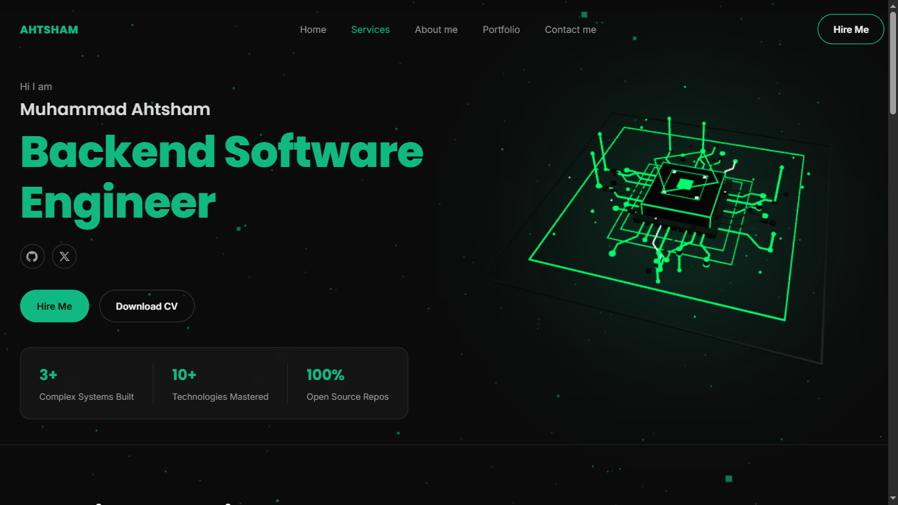
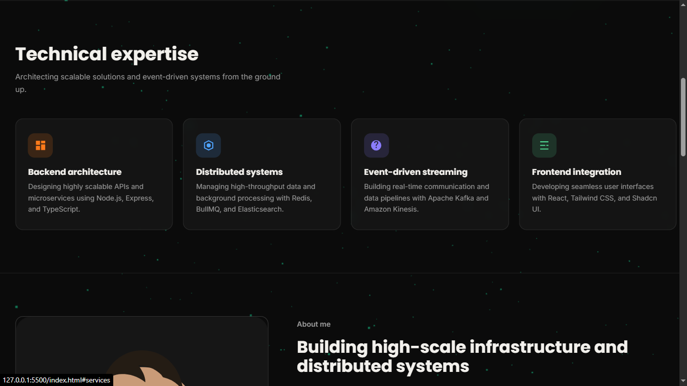
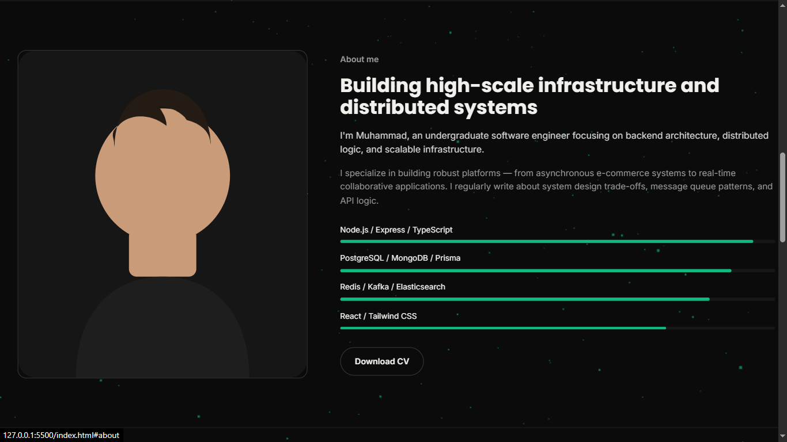
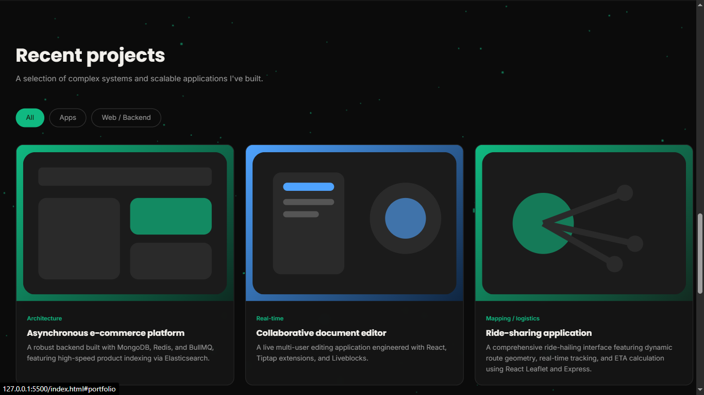
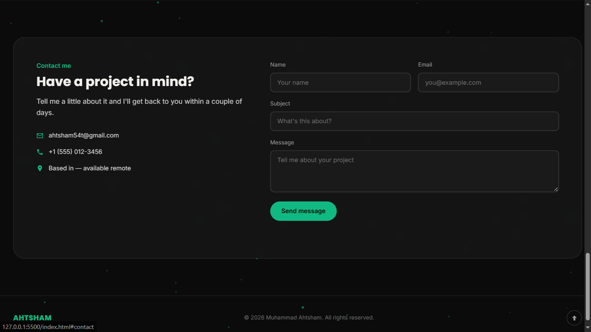

## Objective
To build a professional, responsive developer portfolio using HTML, CSS, and JavaScript.

## Screenshots

### 1. Home Page

### 2. About Section

### 3. Projects Section

### 4. Contact/Other
